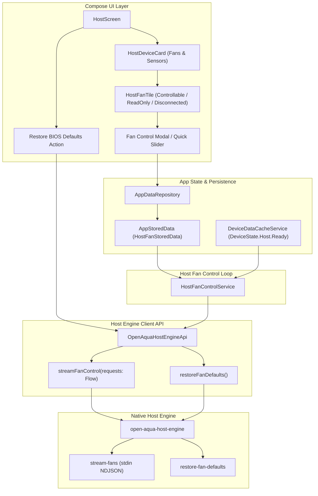

# Host Fan Control — Application Integration Design & Roadmap

This document outlines the architecture, data models, services, and UI integration for host fan control across OpenAqua (`app-compose`), following the completion of the Linux (`sysfs hwmon`) and Windows (`LibreHardwareMonitorLib`) engine implementations.

---

## 1. Current Status & Foundation

- **Platform Host Engines:**
  - **Linux (`engine-host-linux`):** Stateless `hwmon` driver supporting fan RPM readings, PWM percent calculation, BIOS curve detection, safe fallback restoration, and POSIX signal handling.
  - **Windows (`engine-host-windows`):** `LibreHardwareMonitorLib` driver supporting fan RPM sensors, control sensors, software duty cycle override, BIOS default restoration, and process exit handlers.
- **Engine CLI Commands:**
  - `info`: Discovers host devices, temperature sensors, and fan descriptors (`FanControllable`, `FanReadOnly`).
  - `stream-telemetry`: Streams NDJSON telemetry (`Connected`, `Disconnected`, `FanControllableTelemetry`, `FanReadOnlyTelemetry`, `FanDisconnectedTelemetry`).
  - `stream-fans`: Reads NDJSON fan control requests from `stdin` (`HostFanControlRequest(channel, pwmPercent)`).
  - `restore-fan-defaults`: One-shot recovery command to restore all host fan controls to motherboard BIOS/hardware curves.

---

## 2. Architecture & Integration Layers

---

## 3. Layer Breakdown

### Layer 1: Engine Client API (`OpenAquaHostEngineApi`)
File: `app-compose/src/main/kotlin/io/github/lamba92/openaqua/app/repository/OpenAquaHostEngineApi.kt`

- **`streamFanControl(requests: Flow<HostFanControlRequest>)`**:
  - Launches `open-aqua-host-engine stream-fans` via `ProcessBuilder`.
  - Serializes incoming `HostFanControlRequest` objects as NDJSON to the process's standard input.
  - Automatically flushes writes and manages subprocess lifecycle (destroy on cancellation or stream closure).
- **`restoreFanDefaults()`**:
  - Executes `open-aqua-host-engine restore-fan-defaults` with timeout.
  - Safe one-shot trigger to yield control back to the motherboard.

---

### Layer 2: Host Fan Control Service (`HostFanControlService`)
Unlike Aqua Computer hardware which has on-board microcontrollers executing curves in firmware, **host fans require a software controller loop** running on the host OS:

- **Responsibilities:**
  1. Combines live sensor telemetry from `DeviceDataCacheService` (CPU temp, GPU temp, or Aqua Computer coolant sensors) with configured host fan profiles from `AppDataRepository`.
  2. Evaluates fan duty cycles:
     - **Follow BIOS Curve:** Fan is omitted from stream, or defaulted, allowing the motherboard firmware curve to manage it.
     - **Fixed PWM %:** Emits a fixed percentage.
     - **Temperature Curve:** Evaluates curve math based on target sensor temperature and emits calculated duty cycle.
  3. Feeds updates through `openAquaHostEngineApi.streamFanControl(...)`.
  4. Automatically calls `restoreFanDefaults()` upon service shutdown or cancellation.

---

### Layer 3: App Storage & Persistence (`AppStoredData` & `AppDataRepository`)
Files:
- `app-compose/src/main/kotlin/io/github/lamba92/openaqua/app/model/AppStoredData.kt`
- `app-compose/src/main/kotlin/io/github/lamba92/openaqua/app/repository/AppDataRepository.kt`

- **Model: `HostFanStoredData`**:
  - `customName: String?`: User-friendly label (e.g., renaming `hwmon9:fan3` to `"Chipset Fan"`).
  - `mode: HostFanMode`:
    - `FOLLOW_BIOS`: Hardware curve control.
    - `FIXED`: Fixed manual speed percentage.
    - `CURVE`: Follows a temperature curve.
  - `fixedPercent: Double = 50.0`: Target percentage for fixed mode.
  - `curveConfig: HostFanCurveConfig?`:
    - `sensorId: String`: Source sensor identifier (e.g. `hwmon2:temp1` or `aqua-octo:temp1`).
    - `tMin: Double`, `tMax: Double`: Temperature bounds.
    - `pwmMin: Double`, `pwmMax: Double`: Duty cycle bounds.
- **Repository Methods:**
  - `setHostFanCustomName(id: HostFanId, name: String?)`
  - `setHostFanMode(id: HostFanId, mode: HostFanMode)`
  - `setHostFanFixedPercent(id: HostFanId, percent: Double)`
  - `setHostFanCurve(id: HostFanId, curve: HostFanCurveConfig)`

---

### Layer 4: UI & Compose Presentation (`HostScreen`)
Files:
- `app-compose/src/main/kotlin/io/github/lamba92/openaqua/app/feature/host/HostScreen.kt`
- `app-compose/src/main/kotlin/io/github/lamba92/openaqua/app/feature/host/HostContracts.kt`
- `app-compose/src/main/kotlin/io/github/lamba92/openaqua/app/feature/host/HostViewModel.kt`

- **Host Device Fan Tiles (`HostFanTile`):**
  - **Controllable Fan Tile:**
    - Displays current RPM and current PWM %.
    - Mode badge: *"BIOS Curve"* (green/muted) vs *"Manual / Software"* (cyan/active).
    - Quick slider or modal button to adjust speed or assign temperature curve.
  - **Read-Only Fan Tile:**
    - Displays current RPM with a read-only tachometer badge.
  - **Disconnected State:**
    - Hidden when `hideDisconnectedFans` setting is enabled.
    - Dimmed with *"Disconnected"* indicator when visible.
- **Global Action / Panic Button:**
  - *"Restore BIOS Defaults"* button in the Host page top bar, allowing immediate one-click restoration of all fans.

---

### Layer 5: Safety & Failsafe Guarantees

1. **Process Exit Recovery:**
   - Both Linux and Windows host engines register signal and process exit handlers (`SIGINT`, `SIGTERM`, `SIGHUP`, `Console.CancelKeyPress`, `AppDomain.CurrentDomain.ProcessExit`) to restore BIOS curves even on ungraceful shutdown.
2. **App-Level Teardown:**
   - Coroutine scope teardown and repository cleanup invoke `restoreFanDefaults()` in `finally` blocks.
3. **Stateless Defaults:**
   - The engines do not rely on fragile cached state files; `restore-fan-defaults` actively probes and sets hardware registers to auto mode (`"2"` / `"5"` on Linux sysfs, `SetDefault()` on Windows LHM).

---

### Layer 6: Localization & Consistency
- Add localized strings across all 5 supported languages in `strings.xml`:
  - `host_fan_rpm`
  - `host_fan_pwm`
  - `host_fan_following_bios`
  - `host_fan_software_controlled`
  - `host_fan_disconnected`
  - `host_fan_restore_defaults`
  - `host_fan_restore_defaults_dialog`
- Verify with `./gradlew verifyLocalizationConsistency`.
