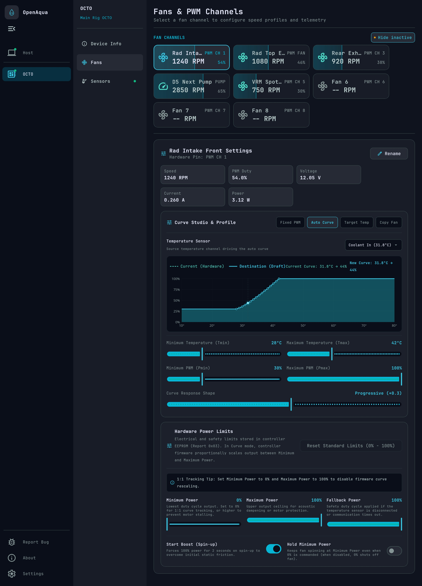
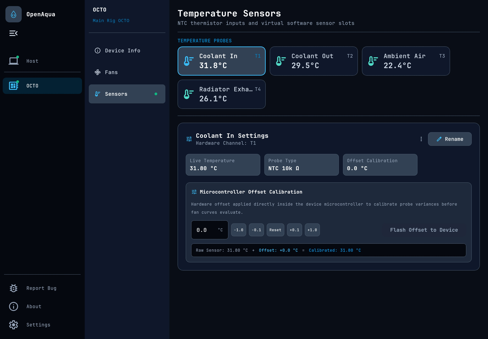
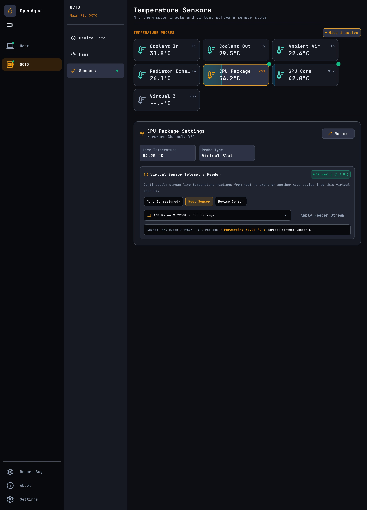
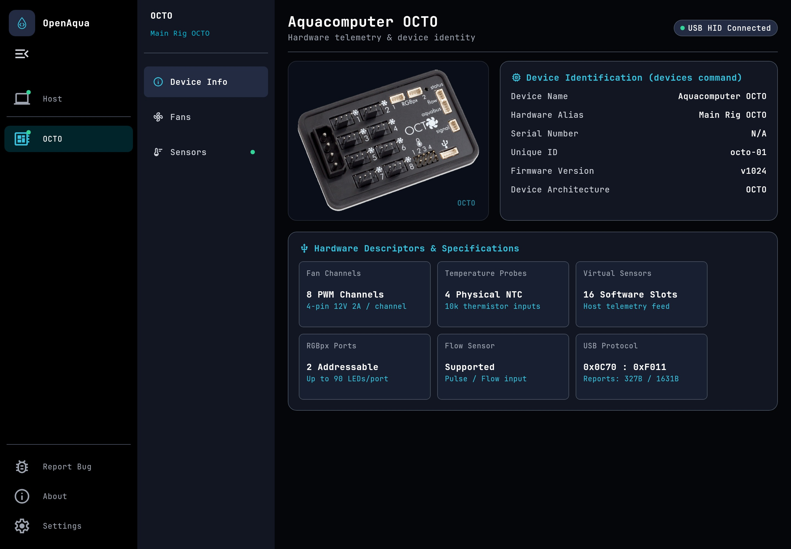

<div align="center">
  <picture>
    <source media="(prefers-color-scheme: dark)" srcset="assets/generated/banner-readme-dark.svg" />
    <source media="(prefers-color-scheme: light)" srcset="assets/generated/banner-readme-light.svg" />
    
  </picture>
</div>

# OpenAqua

> **An open-source, cross-platform thermal management and telemetry suite for Aquacomputer devices, designed for Linux and Windows.**

[](https://kotlinlang.org)
[](https://www.jetbrains.com/lp/compose-multiplatform/)
[](https://github.com/lamba92/open-aqua)
[](LICENSE)

---

## What is OpenAqua?

Aquacomputer hardware (**OCTO**, **QUADRO**, **D5 NEXT**, etc.) represents the gold standard in custom PC liquid cooling and thermal control. However, the official proprietary software (**Aquasuite**) is Windows-only (WPF/.NET) and tied to licensing models. On Linux, users have historically had to rely on Windows virtual machines or incomplete reverse-engineered scripts.

**OpenAqua** provides a modern, transparent, and completely free thermal management solution built with Kotlin and Compose Multiplatform:
- **Autonomous Hardware Operation**: Custom curves and fixed fan profiles are flashed directly to the device's onboard EEPROM/firmware. Once flashed, the device executes the curve in hardware—cooling remains fully active even if the app is closed or the host OS crashes.
- **Modern Compose Desktop UI**: A responsive, themeable desktop interface for visualizing fan curves, monitoring real-time telemetry, calibrating physical sensors, and streaming host temperatures into virtual sensor slots.
- **Cross-Platform**: Designed from the ground up for both **Linux** (native HIDRAW ioctl + sysfs) and **Windows** (native Win32 HID subsystem).
- **Stateless Native Engine**: A lightweight standalone CLI binary (`open-aqua-device-engine`) for headless monitoring, script integration, and daemonless operation.

---

## 📸 Interface Overview

### Fans & Custom Curve Studio
Configure autonomous curve-based or fixed PWM profiles per channel with live RPM feedback and safety minimums:


### Real-Time Sensors & Temperature Offsets
Monitor all hardware temperature channels and flow sensor rates with custom calibration offsets:


### Virtual Temperature Sensor Feeding
Feed host metrics (CPU package, GPU hotspot, etc.) directly into the controller's virtual sensor slots to drive custom cooling curves:


### Device Diagnostics & Hardware Info
Inspect USB descriptors, firmware revisions, hardware serial numbers, and channel layouts:


---

## ⚠️ Supported Hardware & Testing Status

> [!NOTE]
> All Aquacomputer devices share USB Vendor ID `0x0C70`. OpenAqua interfaces directly with hardware over USB HID (using native `hidraw` on Linux with rootless `udev` rules, and the native Win32 HID subsystem on Windows).
>
> - **Physically Verified on Hardware**: Extensively tested on an **Aquacomputer OCTO** under **Linux (Bazzite)** and **Windows**.
> - **Driver & Protocol Support**: Descriptors, telemetry parsing, and EEPROM flash protocols are implemented across the entire Aquacomputer ecosystem based on hardware specifications and reverse engineering. Community feedback and bug reports are warmly welcomed!
> - **Planned Features**: Direct RGBpx / ARGB LED pattern editing and host-side software curve streaming are scheduled for upcoming releases.

### 🎮 Fan & Pump Controllers
| Device | USB Product ID | Cooling Channels | Temperature Sensors | Flow Sensor | Virtual Sensors | Status |
| :--- | :---: | :---: | :---: | :---: | :---: | :--- |
| **Aquacomputer OCTO** | `0xF011` | 8 PWM Channels | 4 Physical (Calibrated NTC) | 1 Calibrated Port | 16 Channels (67B) | 🟢 **Physically Verified & Tested** |
| **Aquacomputer QUADRO** | `0xF00D` | 4 PWM Channels | 4 Physical (Calibrated NTC) | 1 Calibrated Port | 16 Channels (67B) | 🟢 **Full Protocol & Limits Support** |
| **Aquacomputer Aquaero 5 / 6** | `0xF001` | 4 Channels (PWM / Voltage) | Up to 8 Physical Inputs | 2 Flow Inputs | — | 🟢 **Descriptor & Telemetry Support** |
| **Aquacomputer Poweradjust 3** | `0xF0BD` | 1 High-Power Channel | 1 Physical Input | — | — | 🟢 **Descriptor & Telemetry Support** |

### 💧 Smart Pumps
| Device | USB Product ID | Cooling Channels | Temperature Sensors | Flow Sensor | Virtual Sensors | Status |
| :--- | :---: | :---: | :---: | :---: | :---: | :--- |
| **Aquacomputer D5 NEXT** | `0xF00E` | 2 (Pump + Fan Output) | 1 Integrated Coolant Temp | Virtual / Calculated | 8 Channels (51B) | 🟢 **Full Protocol & Telemetry Support** |
| **Aquacomputer Aquastream Ultimate** | `0xF00B` | 2 (Pump + Fan Output) | Internal + External Inputs | Calibrated Port | — | 🟢 **Descriptor & Telemetry Support** |
| **Aquacomputer Aquastream XT** | `0xF0B6` | 2 (Pump + Fan Output) | 1 External Input | — | — | 🟢 **Descriptor & Telemetry Support** |

### 📊 Sensors & System Protection
| Device | USB Product ID | Primary Functions | Temperature Sensors | Display / Indicators | Status |
| :--- | :---: | :---: | :---: | :---: | :--- |
| **Aquacomputer HIGH FLOW NEXT** | `0xF012` | High-precision Flow Rate, Coolant Quality & Electrical Conductivity | Integrated Coolant Temp | OLED + RGBpx | 🟢 **Telemetry & Sensor Parsing** |
| **Aquacomputer High Flow USB** | `0xF003` | Dedicated Flow Rate & Telemetry | 1 Physical Input | — | 🟢 **Telemetry & Sensor Parsing** |
| **Aquacomputer LEAKSHIELD** | `0xF014` | Vacuum-based Leak Prevention, Pressure Sensing & Deaeration | Pressure / Vacuum Sensor | OLED + RGBpx | 🟢 **Telemetry & Status Monitoring** |

### 🌈 Lighting & RGBpx Controllers
| Device | USB Product ID | Lighting Outputs | Temperature Sensors | Virtual Sensors | Status |
| :--- | :---: | :---: | :---: | :---: | :--- |
| **Aquacomputer FARBWERK 360** | `0xF010` | 4 Addressable RGBpx Ports (up to 360 ARGB LEDs) | 4 Physical Inputs | 16 Channels (67B) | 🟢 **Descriptor & Sensor Support** |
| **Aquacomputer FARBWERK (Classic)** | `0xF00A` | 4 Analog 12V RGB Channels | 4 Physical Inputs | — | 🟢 **Descriptor & Sensor Support** |

---

## 📥 Direct Downloads & Standalone Packages (Recommended)

Pre-packaged standalone release artifacts are available directly on [**GitHub Releases**](https://github.com/lamba92/open-aqua/releases/latest):

### Linux (x86_64)
- **AppImage**: Standalone portable bundle ([open-aqua-1.0.3-linux-x64.AppImage](https://github.com/lamba92/open-aqua/releases/download/1.0.3/open-aqua-1.0.3-linux-x64.AppImage))
- **DEB**: Debian / Ubuntu package ([open-aqua_1.0.3_amd64.deb](https://github.com/lamba92/open-aqua/releases/download/1.0.3/open-aqua_1.0.3_amd64.deb))
- **RPM**: Fedora / openSUSE / RHEL package ([open-aqua-1.0.3-1.x86_64.rpm](https://github.com/lamba92/open-aqua/releases/download/1.0.3/open-aqua-1.0.3-1.x86_64.rpm))
- **Tarball**: Standalone archive ([open-aqua-1.0.3-linux-x64.tar.gz](https://github.com/lamba92/open-aqua/releases/download/1.0.3/open-aqua-1.0.3-linux-x64.tar.gz))
- **Native Engine CLI**: Headless standalone binary ([open-aqua-device-engine-1.0.3-linux-x64](https://github.com/lamba92/open-aqua/releases/download/1.0.3/open-aqua-device-engine-1.0.3-linux-x64))

### Windows (x86_64)
- **MSIX Package**: Windows app package ([open-aqua-1.0.3.msix](https://github.com/lamba92/open-aqua/releases/download/1.0.3/open-aqua-1.0.3.msix))
- **MSI Installer**: Windows installer package ([open-aqua-1.0.3.msi](https://github.com/lamba92/open-aqua/releases/download/1.0.3/open-aqua-1.0.3.msi))
- **Portable ZIP**: Standalone archive ([open-aqua-1.0.3-windows-x64.zip](https://github.com/lamba92/open-aqua/releases/download/1.0.3/open-aqua-1.0.3-windows-x64.zip))
- **Native Engine CLI**: Headless standalone executable ([open-aqua-device-engine-1.0.3-windows-x64.exe](https://github.com/lamba92/open-aqua/releases/download/1.0.3/open-aqua-device-engine-1.0.3-windows-x64.exe))

---

## 📦 App Stores & Distribution Status

| Channel / Store | Platform | Status & Installation |
| :--- | :---: | :--- |
| **Snap Store** | Linux | `sudo snap install open-aqua`<br>*(Published to `stable` channel)* |
| **Flathub** | Linux | ⏳ **Under Review** ([Submission PR #11084](https://github.com/flathub/flathub/pull/11084))<br>Test build ref:<br>`flatpak install --user https://dl.flathub.org/build-repo/338893/io.github.lamba92.openaqua.flatpakref` |
| **Microsoft Store** | Windows | ⏳ **Submission Pending Review**<br>*(Direct MSIX & MSI packages available above)* |
| **Arch Linux (AUR)** | Linux | ⏳ **In Progress** (`open-aqua-bin`) |

---

## 🔒 Platform Details & Permissions

### Linux
- **Driver**: Communicates with the kernel's `/dev/hidraw*` interface via `HIDIOCGFEATURE` and `HIDIOCSFEATURE` ioctls.
- **Rootless USB Access (udev)**: The desktop application includes a one-click udev configuration under Settings. Alternatively, create `/etc/udev/rules.d/99-aquacomputer.rules` manually:
  ```udev
  SUBSYSTEM=="hidraw", ATTRS{idVendor}=="0c70", MODE="0666", TAG+="uaccess"
  ```
  Apply rules:
  ```bash
  sudo udevadm control --reload-rules && sudo udevadm trigger
  ```

### Windows
- **Driver**: Uses native Win32 HID APIs (`hid.dll` via Kotlin/Native cinterop).
- **Report Routing**:
  - Control configuration (Report `0x03`): Transferred via `HidD_SetFeature`.
  - Commit trigger (Report `0x02`): Written via `HidD_SetOutputReport` matching Windows HID report descriptors.
- No third-party drivers (like WinUSB or libusbK) required; works out-of-the-box with Windows default HID class driver.

---

## 🛠️ Standalone Engine CLI (`open-aqua-device-engine`)

For headless systems, automation, or integration with external scripts, the native engine CLI provides JSON / NDJSON output:

```bash
$ open-aqua-device-engine --help
Usage: open-aqua-device-engine [<options>] <command> [<args>]...

  OpenAqua native hardware engine CLI. Provides low-level USB HID hardware
  control for Aquacomputer devices.
```

### 1. Discover Connected Devices
```bash
$ open-aqua-device-engine devices
```
```json
{
  "devices": [
    {
      "id": "10000-00001",
      "alias": "octo-1",
      "type": "OCTO",
      "name": "Aquacomputer OCTO",
      "serial": "10000-00001",
      "firmwareVersion": 1020
    }
  ]
}
```

### 2. Inspect Hardware Descriptors
```bash
$ open-aqua-device-engine descriptors --type OCTO --pretty
```

### 3. Read Snapshot Telemetry
```bash
$ open-aqua-device-engine telemetry --device octo-1 --pretty
```
```json
{
  "type": "octo",
  "flowRateDlH": 182,
  "fans": [
    {
      "channel": 0,
      "rpm": 2310,
      "powerWatts": 0.0,
      "voltageVolts": 12.03,
      "currentAmps": 0.0,
      "pwmPercent": 24.0
    }
  ],
  "sensors": [
    {
      "channel": 0,
      "tempCelsius": 36.2,
      "isVirtual": false
    }
  ]
}
```

### 4. Continuous Telemetry Streaming (NDJSON)
Stream live telemetry samples as line-delimited JSON for logging or feeding into Home Assistant / Prometheus:
```bash
$ open-aqua-device-engine stream-telemetry --device octo-1
```

### 5. Read Hardware EEPROM Configuration
```bash
$ open-aqua-device-engine config read --device octo-1 --pretty
```

### 6. Flash Hardware Configuration
Atomically flash modified fan curves or fixed PWM settings into EEPROM:
```bash
$ open-aqua-device-engine config flash --device octo-1 --request '{"fans":{"0":{"type":"fixed","channel":0,"powerPercent":50.0}}}'
```
Or flash from a profile file:
```bash
$ open-aqua-device-engine config flash --device octo-1 --file custom-profile.json
```

### 7. Feed Software / Virtual Temperature Sensors
Stream external temperature readings (e.g. CPU package, GPU hotspot) from host monitoring tools directly to the hardware's virtual sensor slots:
```bash
$ echo '{"sensors":{"0":45.2,"1":58.0}}' | open-aqua-device-engine feed-virtual-sensors --device octo-1
```

---

## 🏗️ Building from Source

### Prerequisites
- **JDK 21+** (Temurin, Corretto, etc.)
- C compiler toolchain for native modules (GCC/Clang on Linux, MinGW on Windows)

### Build Desktop Application
```bash
# Run desktop application in development mode
./gradlew :app-compose:app-compose-prod:run

# Package AppImage (Linux)
./gradlew :packaging:packageReleaseAppImage

# Install AppImage to ~/.local with desktop menu integration (Linux)
./gradlew :packaging:installReleaseAppImage

# Build all release packages for the current OS (AppImage, deb, rpm, tar.gz or MSI, zip, MSIX)
./gradlew release
```

### Build Native Engine CLI
```bash
# Build Linux production native engine binary
./gradlew :engine:engine-device:engine-device-prod:linkReleaseExecutableLinuxX64

# Build Windows production native engine binary
./gradlew :engine:engine-device:engine-device-prod:linkReleaseExecutableMingwX64
```
Binaries will be placed in `engine/engine-device/engine-device-prod/build/bin/<target>/releaseExecutable/`.

### Run Tests & Quality Checks
```bash
# Run unit tests and ktlint checks across all modules
./gradlew check

# Run live hardware tests on Linux (requires connected Aquacomputer OCTO)
./gradlew :engine:engine-device:engine-device-prod:linuxX64Test -Ptest.hardware=true

# Re-generate screenshots
./gradlew :app-compose:app-compose-screenshots:generateScreenshots
```

---

## 📚 Further Documentation

- **[assets/BRAND_GUIDELINES.md](assets/BRAND_GUIDELINES.md)**: Brand color palette, typography, and icon asset specifications.
- **[docker/windows-test/README.md](docker/windows-test/README.md)**: Automated Docker + QEMU/KVM Windows testing environment for validating Windows builds against physical USB devices.

---

## License

OpenAqua is licensed under the Apache License, Version 2.0. See [LICENSE](LICENSE) for details.
